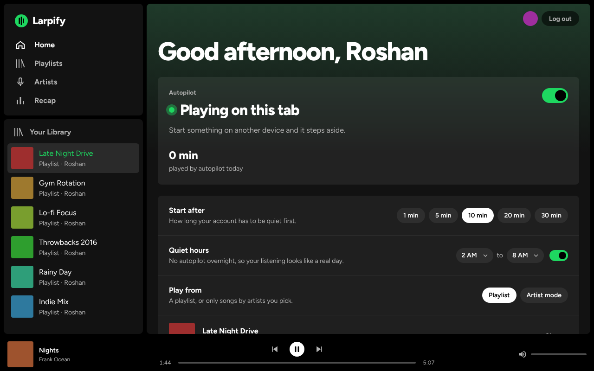
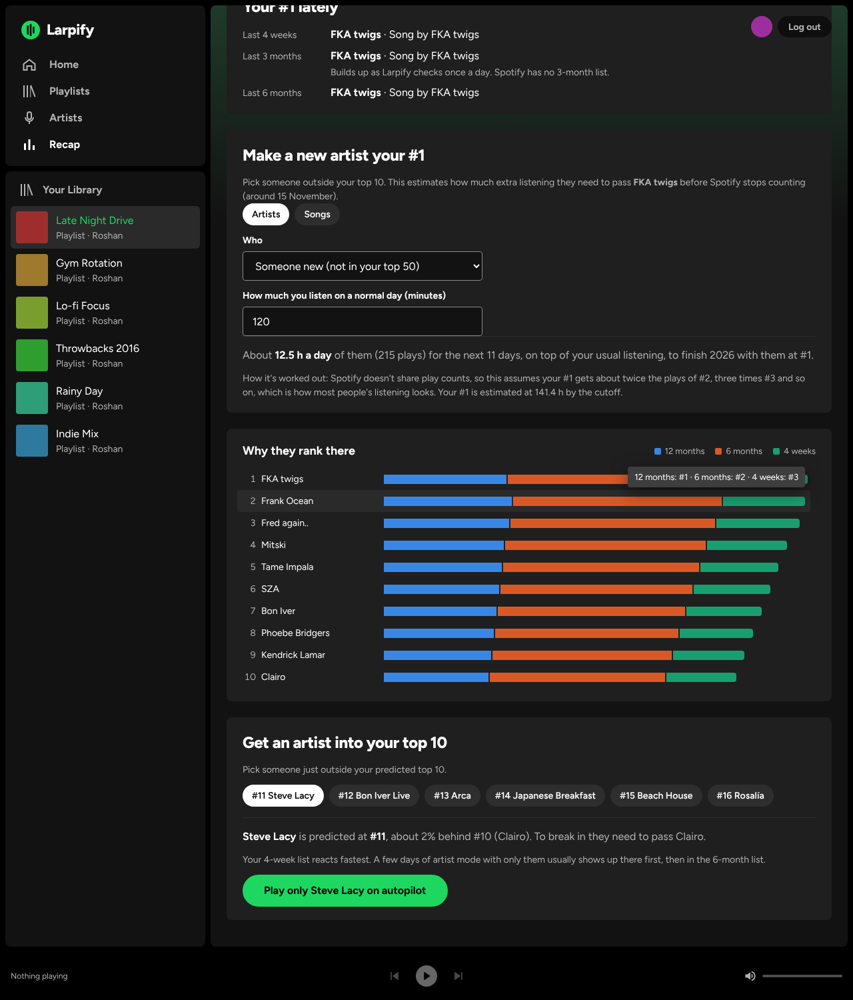
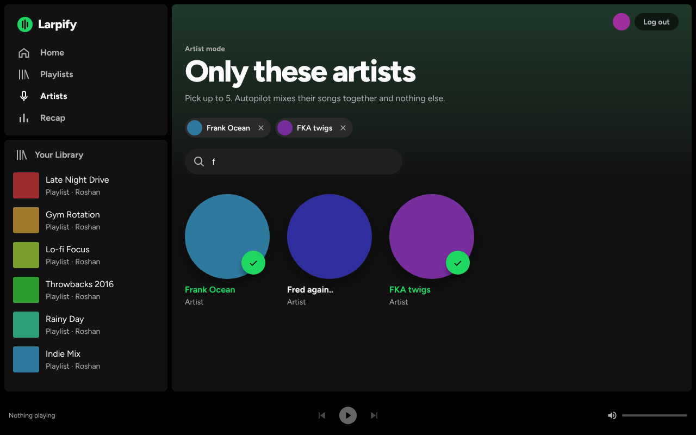
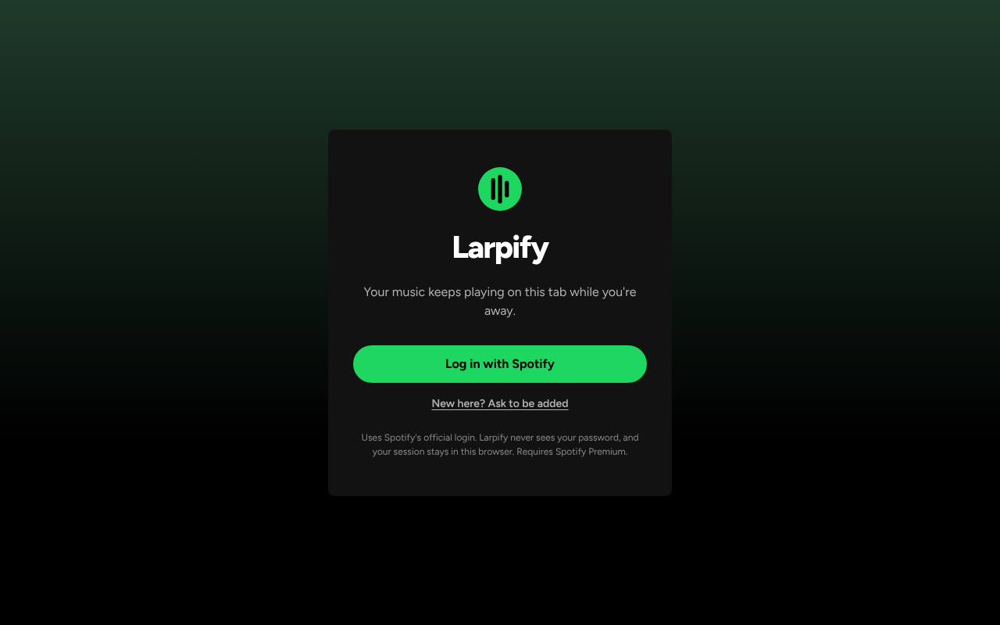
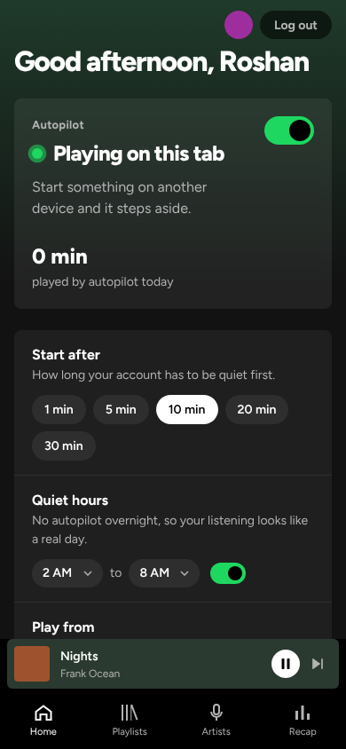
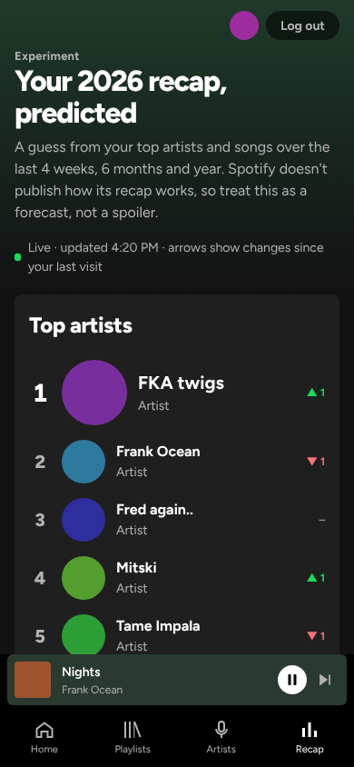

# Larpify: 

Keeps your Spotify going while you're away. Larpify runs a Spotify player inside a browser tab, watches your account, and when nothing has played for a while it starts your chosen playlist (or a mix of only the artists you pick) on that tab. The moment you play something on your phone or desktop app, it steps aside.

A fun project for a few friends.



## Features

- Log in with Spotify's official OAuth (Authorization Code + PKCE). No password or client secret ever touches the app.
- **Autopilot**: starts after 1–30 minutes of inactivity and hands control back as soon as you play anything elsewhere.
- **Quiet hours**: no autopilot overnight (2 AM to 8 AM by default), so your listening looks like a real day.
- **Playlist mode**: shuffle one of your playlists.
- **Artist mode**: pick up to 5 artists and get a shuffled, interleaved mix of only their songs.
- **Recap prediction**: a live guess at your year-end top 5 artists and songs, with daily rank changes, a chart of where each artist's score comes from, and a one-click way to push an artist into your top 5.
- Spotify-style interface that works on desktop and phone, with a player bar you can control.
- Keeps the screen awake while autopilot is on, recovers by itself if the player drops, and can open at Windows sign-in.

## Screenshots

Taken with sample data (`npm run screenshots` regenerates them).

| Recap prediction | Artist mode |
| --- | --- |
|  |  |

| Login | On a phone | Recap on a phone |
| --- | --- | --- |
|  |  |  |

## Setup

You need Node 22+ and Spotify Premium (the browser player requires it).

1. Go to the [Spotify developer dashboard](https://developer.spotify.com/dashboard) and create an app.
   - Under **Which API/SDKs are you planning to use**, tick **Web API** and **Web Playback SDK**.
   - Add the Redirect URIs `http://127.0.0.1:5173/` (local) and your Vercel URL, e.g. `https://larpify.vercel.app/`. They must match exactly, including the trailing slash.
   - Under **User Management**, add the Spotify email of every friend who will use it. Apps in development mode only work for listed users.
2. Copy the env file and paste in your **Client ID** (never the client secret, which Larpify doesn't use):
   ```sh
   cp .env.example .env.local
   ```
3. Install and run:
   ```sh
   npm install
   npm run dev
   ```
   Open http://127.0.0.1:5173/. Use `127.0.0.1` rather than `localhost`, because Spotify rejects `localhost` redirects.

## Deploying to Vercel

1. Import the GitHub repo in Vercel. It detects Vite; `vercel.json` sets the build and security headers.
2. In **Settings → Environment Variables**, add `VITE_SPOTIFY_CLIENT_ID`, and `VITE_SPOTIFY_REDIRECT_URI` set to your main address (e.g. `https://larpify.vercel.app/`). The second one sends visitors on Vercel's one-off deployment links to the main address, where login works.
3. Deploy, then add the production URL (with trailing slash) as a Redirect URI in the Spotify dashboard.

Preview deployments get random URLs that Spotify won't accept, so test login on the production URL (or add a fixed preview domain to the dashboard).

## Keeping it running

Larpify can't run without an open browser tab: Spotify's player needs a real browser, and it deliberately won't work in headless or cloud setups. For unattended use, dedicate a spare machine (old laptop, mini PC) to the tab. The app keeps the screen awake while autopilot is on and reloads itself if the player drops for a couple of minutes.

**Setting up a spare machine (Windows, Chrome or Edge):**
1. Settings → System → Power: set sleep and screen-off to **Never** while plugged in. Closing the lid should do nothing.
2. In the browser, open **Settings → Performance** and add your Larpify address under **Always keep these sites active**.
3. Open your Larpify address, log in, switch autopilot on, and click the page once.
4. Make it open when Windows starts. In the repo's `scripts/autostart` folder, run:
   ```powershell
   powershell -ExecutionPolicy Bypass -File .\install-windows.ps1 -Url https://your-address/
   ```
   It adds a Startup shortcut that opens Larpify in its own window. Log in there once; after a restart it plays without needing a click. Undo it with `uninstall-windows.ps1` (add `-RemoveProfile` to also clear its saved login). For a machine that restarts by itself after power cuts, also turn on automatic sign-in for that Windows account.
5. Spotify allows only one active stream per account: if you start something on another device, autopilot steps aside on its own.

- Keep the tab open. Closing it stops the player.
- Chrome and Edge put background tabs to sleep. Add the site under **Settings → Performance → Always keep these sites active**.
- Browsers block sound until you've clicked the page once, so click anywhere after opening it.
- If your computer sleeps, so does the tab.

## Scripts

| Command            | What it does                                              |
| ------------------ | --------------------------------------------------------- |
| `npm run dev`      | Dev server on http://127.0.0.1:5173                       |
| `npm run build`    | Type-check and build to `dist/`                           |
| `npm run lint`     | ESLint                                                    |
| `npm test`         | Unit tests (autopilot, quiet hours, recap model, PKCE)    |
| `npm run test:e2e` | Browser tests on desktop and phone sizes, Spotify mocked  |
| `npm run screenshots` | Regenerate the README screenshots from sample data     |

GitHub Actions runs all of these on every push, plus a [gitleaks](https://github.com/gitleaks/gitleaks) scan of the full history.

## Security

- **No secrets anywhere.** PKCE means there is no client secret. The Client ID is a public identifier, but it still lives in `.env.local` (git-ignored) and Vercel's env settings, not in the code.
- **Tokens stay in your browser.** There is no backend. Access and refresh tokens are kept in the tab's local storage and removed on log out.
- **Minimal scopes**: only playback, profile and reading your playlists. Larpify can't modify your library or playlists.
- **Locked-down page**: a Content Security Policy only allows scripts from this site and Spotify's player, plus headers that stop other sites from framing it.
- **Checks on every push**: gitleaks on the git history, a scan of the built bundle, and `npm audit`.


Larpify isn't affiliated with or endorsed by Spotify. "Spotify" is a trademark of Spotify AB.

LARP LARP LARP SAHUUURRR

## License

MIT
